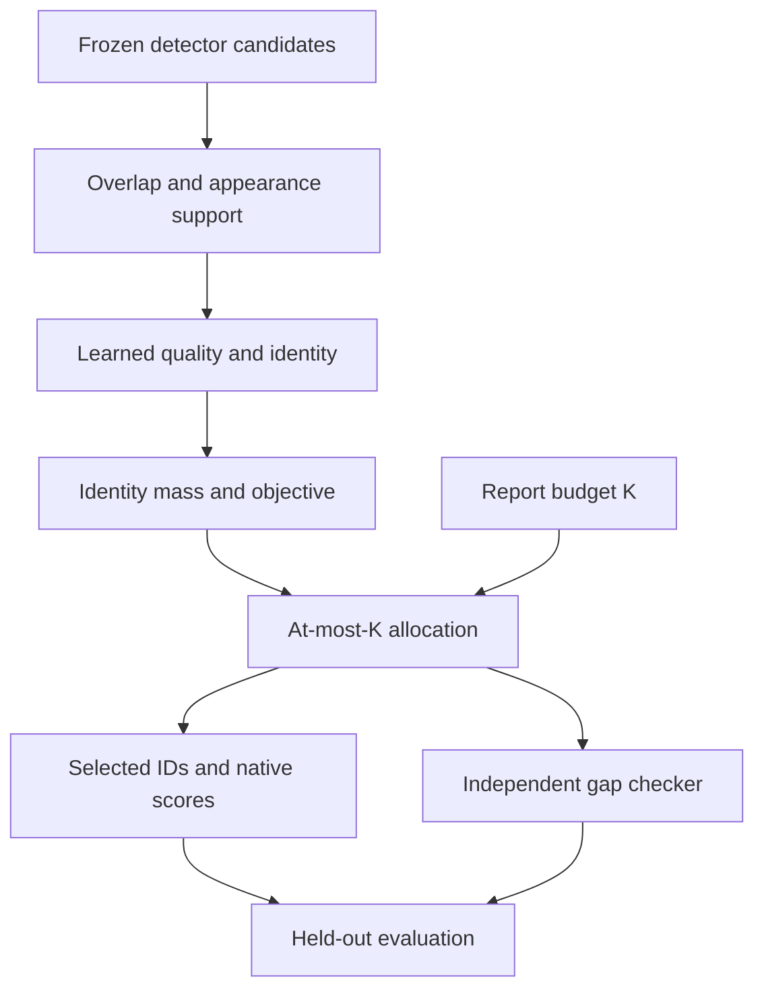

# DIAL-Det

### Learning identity mass for budgeted detection allocation

**DIAL-Det selects a report of at most $K$ detections from a frozen detector's candidates.** Its central question is whether a report slot should hold another box for an already represented object or a candidate for a distinct object. Learned identity mass makes coverage reflect objects even when some objects have many more candidate boxes than others. The budget enters the allocation itself, so the same objective governs admission while slots remain and replacement when the report is full.

This repository provides the DIAL-Det reference implementation: frozen candidate export, a trainable two-branch evidence network, identity-mass-normalized allocation, independent certificate checking, dataset evaluation, and reproducible experiment workflows. The [implementation map](docs/IMPLEMENTATION_STATUS.md) connects each component to its code and tests and states the supported experimental scope.

**Start here:** [Method](docs/METHOD.md) · [Reviewer guide](docs/REVIEWER_GUIDE.md) · [COCO study](docs/COCO_STUDY.md) · [Validation](VALIDATION_REPORT.md) · [Arrhenius](README_ARRHENIUS.txt)

## Why identity mass matters

- **Equal value for one identity.** If one object has three equivalent candidates and another has one, unnormalized coverage can value the first three times as much. Dividing each demand unit by its identity mass gives each ideal identity block total demand one.
- **A budget changes the decision.** A candidate's value depends on the report already selected and the alternatives competing for its remaining slots. The allocator optimizes across cardinalities from zero to $K$; distinct overlapping objects remain admissible.
- **Optimization error is visible.** Each numerical certificate bounds the returned report's objective gap. Matching audits then measure allocation shortfall, while benchmark evaluators measure detection performance. These answer different questions.

These properties follow from the paper's Sections 1–2 and supplement Appendices C–D. [The method guide](docs/METHOD.md) connects them to the equations and their assumptions; [source provenance](SOURCE_PROVENANCE.json) identifies the scientific specification.

## Method at a glance



The encoder never receives $K$. Ground truth supplies training targets and retrospective audits; inference support and evidence depend only on frozen candidates.

For quality $q_i$ and calibrated identity affinity $r_{ij}$, define

$$
s_{ij}=r_{ij}^{p},\qquad d_u=\sum_j s_{ju},\qquad
\widetilde r_{ij}=s_{ij}\mathbf{1}\{s_{ij}\ge\theta\}.
$$

Then choose $S\subseteq V$ with $|S|\le K$ to maximize

$$
F(S)=\sum_{i\in S}(q_i-\rho)
+\eta\sum_u\frac{\max_{i\in S}q_i\widetilde r_{iu}}{d_u}
-\lambda\sum_{\{i,j\}\subseteq S}\widetilde r_{ij}\min(q_i,q_j).
$$

**Mass uses every supported affinity before thresholding.** It stays fixed during search, splitting and swaps. The threshold applies to $r^p$, and the empty-set maximum is zero. Defaults are $(\rho,\eta,\lambda,p,\theta)=(0.08,0.2,1.25,2,0.05)$.

Under ideal identity blocks and calibrated qualities, every optimum keeps at most one candidate per block, and a duplicate-free report has $F(S)=(1+\eta)\mathbb{E}[C(S)]-\rho|S|$. This explains the normalization; measured gains with learned evidence require the actual held-out experiments.

## Supported detector and datasets

The built-in exporter supports **torchvision Faster R-CNN ResNet-50-FPN**. It bypasses final RoI detection NMS, retains RPN proposal processing, and freezes up to 500 candidate IDs, boxes, classes, native scores and appearance features per image. Other detector families need their own exporter implementing the [candidate contract](IMPLEMENTATION_NOTES.md#2-frozen-candidate-contract).

| Dataset | Native annotation input | Quality used by the allocator | Evaluation |
|---|---|---|---|
| COCO | Instances JSON | Mean of ten probabilities at IoU 0.50–0.95 | Official `pycocotools` AP; global $K$ applied before the evaluator's per-category cap |
| CrowdHuman | Full-body ODGT, including ignore regions | Probability at IoU 0.50 | Native prediction ODGT; AP50/MR through a local upstream CrowdDetection evaluator checkout; JI remains external |
| CityPersons | Official MATLAB annotations | Probability at IoU 0.50 | Candidate export, training, allocation and matching audits; official CityPersons MR remains external |

The CLI selects the dataset's quality target from the manifest and rejects conflicting explicit dataset options. The implemented comparison track changes membership and preserves native detector scores. See the [dataset workflows](docs/DATASETS.md) for export and evaluation commands, and [status and limitations](docs/IMPLEMENTATION_STATUS.md) for additional detectors, comparison tracks and controls.

## Quick local verification

From this repository, use Python 3.10 or later:

```bash
python -m pip install -r requirements.txt
python run_dialdet_arrhenius.py self-test --output test_results
python run_dialdet_arrhenius.py smoke --output synthetic_check
```

For learned evidence, install a compatible PyTorch/torchvision build for your host, then run:

```bash
python -m pip install -r requirements_optional.txt
python run_dialdet_arrhenius.py self-test --neural --output neural_tests
python run_dialdet_arrhenius.py smoke --neural --device cpu --output neural_check
```

The neural smoke trains for two epochs, fits development temperature, performs held-out inference and replays allocation certificates on synthetic data. It is a functional check. [VALIDATION_REPORT.md](VALIDATION_REPORT.md) records the validation evidence and its scope.

The release checker also verifies package hashes, imports, CLI routing and shell syntax. Use an output directory outside the source tree:

```bash
python scripts/release_check.py --neural --output ../dialdet_release_check
```

## Start a COCO study

Export a real frozen candidate pool using your images, annotations and compatible detector checkpoint:

```bash
python run_dialdet_arrhenius.py export-coco \
  --images /path/coco/val2017 \
  --annotations /path/coco/annotations/instances_val2017.json \
  --weights /path/fasterrcnn_resnet50_fpn.pt \
  --device cuda --output /path/coco_frozen
```

Copy and complete [configs/coco_study.example.json](configs/coco_study.example.json) with actual paths. The study command first prepares a reviewable execution plan:

```bash
python run_dialdet_arrhenius.py study \
  --specification configs/coco_study.example.json --output /path/coco_study
```

Run the planned study in an environment with the required compute allocation:

```bash
python run_dialdet_arrhenius.py study \
  --specification configs/coco_study.example.json --output /path/coco_study --execute
```

The default design uses five encoder seeds and two cross-fit folds. Each fold fits and tunes on the opposite half; each image appears once in the combined held-out predictions for a seed. **Compute AP on that union, then average dataset AP across seeds.** Paired image–seed statistics preserve this estimand. See the [COCO study guide](docs/COCO_STUDY.md) for configuration, execution, `--resume`, outputs and the precise supported statistical comparisons.

Public-checkpoint cross-fitting provides held-out encoder evaluation. It does not qualify for the paper's focal-detector population risk certificate. The separate complete-policy risk workflow is documented in the [experiment guide](docs/EXPERIMENTS.md#complete-policy-risk-workflow).

## Arrhenius deployment

The Arrhenius launchers use account `naiss2025-5-643-gpu`, partition `gpu`, storage root `/nobackup/proj/disk/naiss2025-6-428/from-alvis/tnnls`, and the GH200 environment. Install the repository at `<storage-root>/code/dialdet_reconstruction`, then preview and submit a smoke job:

```bash
DIAL_DRY_RUN=1 bash submit_dialdet_arrhenius.sh smoke
bash submit_dialdet_arrhenius.sh smoke
```

[README_ARRHENIUS.txt](README_ARRHENIUS.txt) gives the exact modules, environment path, data settings, submission options and per-stage commands. Normal jobs reuse the environment and install no dependencies. `full` denotes one 30-epoch pipeline for one fold and seed; the [study workflow](docs/COCO_STUDY.md) orchestrates the repeated COCO experiment.

## Evidence a reader can inspect

Each completed CLI stage records inputs, source identity, arguments and output hashes in `RUN_MANIFEST.json`, with execution status in `RUN_STATUS.json`. Prediction artifacts bind selected candidates to their evidence and policy configuration; DIAL-Det outputs also record the certificate and its status. `verify-run` checks those recorded identities; `compare-results` connects a reported value to a numeric field in a verified, nonsynthetic run artifact. The [experiment guide](docs/EXPERIMENTS.md) documents their schemas and commands.

The recorded validation covers numerical behavior, training integration, synthetic experiments, package installation and launch interfaces. Benchmark claims require completed studies on the intended detector, dataset, population and compute platform; the validation report identifies the checks actually executed.

For a review, follow [REVIEWER_GUIDE.md](docs/REVIEWER_GUIDE.md). For development, use the [method-to-code-to-tests map](docs/IMPLEMENTATION_STATUS.md#method-to-code-to-tests), [focused ablation configurations](docs/ABLATIONS.md), [implementation notes](IMPLEMENTATION_NOTES.md), and [source provenance](SOURCE_PROVENANCE.json). Repository setup is described in [GITHUB_SETUP.md](docs/GITHUB_SETUP.md).
